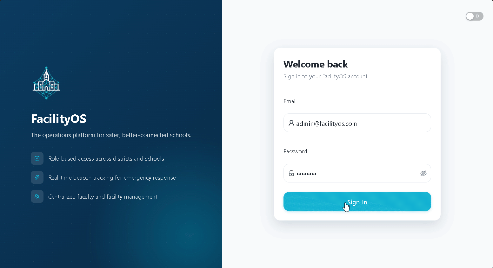
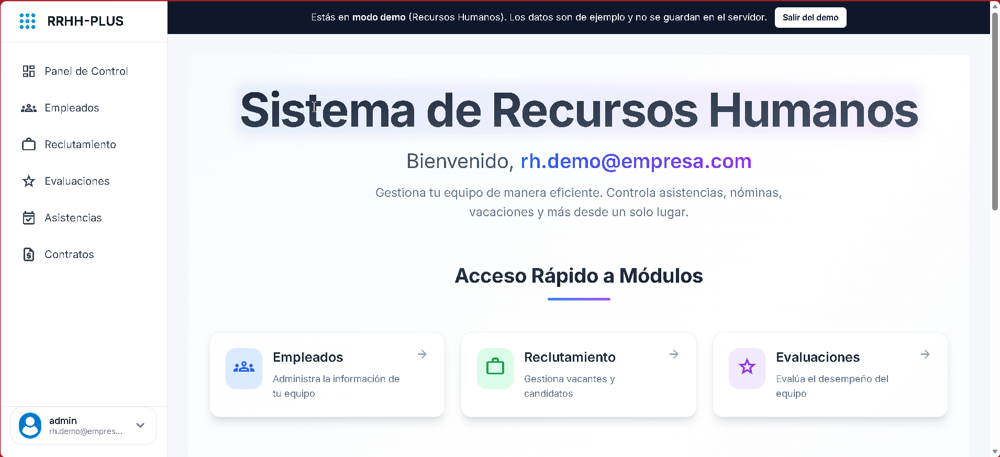

<a href="https://darmixista.dev"><picture><source media="(prefers-color-scheme: dark)" srcset="./assets/header-dark.svg"><source media="(prefers-color-scheme: light)" srcset="./assets/header-light.svg"></picture></a>

  <a href="https://darmixista.dev"><picture><source media="(prefers-color-scheme: dark)" srcset="./assets/btn-portfolio-dark.svg"><source media="(prefers-color-scheme: light)" srcset="./assets/btn-portfolio-light.svg"></picture></a>
  <a href="https://www.linkedin.com/in/orlandogalvan-dev"><picture><source media="(prefers-color-scheme: dark)" srcset="./assets/btn-linkedin-dark.svg"><source media="(prefers-color-scheme: light)" srcset="./assets/btn-linkedin-light.svg"></picture></a>
  <a href="mailto:orlando.gal.var.05@gmail.com"><picture><source media="(prefers-color-scheme: dark)" srcset="./assets/btn-email-dark.svg"><source media="(prefers-color-scheme: light)" srcset="./assets/btn-email-light.svg"></picture></a>

 

<picture><source media="(prefers-color-scheme: dark)" srcset="./assets/sec-about-dark.svg"><source media="(prefers-color-scheme: light)" srcset="./assets/sec-about-light.svg"></picture>

<picture><source media="(prefers-color-scheme: dark)" srcset="./assets/about-dark.svg"><source media="(prefers-color-scheme: light)" srcset="./assets/about-light.svg"></picture>

 

<picture><source media="(prefers-color-scheme: dark)" srcset="./assets/sec-experience-dark.svg"><source media="(prefers-color-scheme: light)" srcset="./assets/sec-experience-light.svg"></picture>

<picture><source media="(prefers-color-scheme: dark)" srcset="./assets/experience-dark.svg"><source media="(prefers-color-scheme: light)" srcset="./assets/experience-light.svg"></picture>

 

<picture><source media="(prefers-color-scheme: dark)" srcset="./assets/sec-stack-dark.svg"><source media="(prefers-color-scheme: light)" srcset="./assets/sec-stack-light.svg"></picture>

<picture><source media="(prefers-color-scheme: dark)" srcset="./assets/stack-dark.svg"><source media="(prefers-color-scheme: light)" srcset="./assets/stack-light.svg"></picture>

 

<picture><source media="(prefers-color-scheme: dark)" srcset="./assets/sec-projects-dark.svg"><source media="(prefers-color-scheme: light)" srcset="./assets/sec-projects-light.svg"></picture>

<table>
  <tr>
    <td width="50%" valign="top">
      
      <picture><source media="(prefers-color-scheme: dark)" srcset="./assets/project-facilityos-dark.svg"><source media="(prefers-color-scheme: light)" srcset="./assets/project-facilityos-light.svg"></picture>
      

        <a href="https://9caeeece.facilityos-9er.pages.dev"><picture><source media="(prefers-color-scheme: dark)" srcset="./assets/btn-demo-dark.svg"><source media="(prefers-color-scheme: light)" srcset="./assets/btn-demo-light.svg"></picture></a>
        <a href="https://github.com/OrlandoGalvanVargas/facilityos"><picture><source media="(prefers-color-scheme: dark)" srcset="./assets/btn-source-dark.svg"><source media="(prefers-color-scheme: light)" srcset="./assets/btn-source-light.svg"></picture></a>
      

    </td>
    <td width="50%" valign="top">
      
      <picture><source media="(prefers-color-scheme: dark)" srcset="./assets/project-rhplus-dark.svg"><source media="(prefers-color-scheme: light)" srcset="./assets/project-rhplus-light.svg"></picture>
      

        <a href="https://system-rrhh-plus.netlify.app/"><picture><source media="(prefers-color-scheme: dark)" srcset="./assets/btn-demo-dark.svg"><source media="(prefers-color-scheme: light)" srcset="./assets/btn-demo-light.svg"></picture></a>
        <a href="https://github.com/OrlandoGalvanVargas/react-rrhh-plus-"><picture><source media="(prefers-color-scheme: dark)" srcset="./assets/btn-source-dark.svg"><source media="(prefers-color-scheme: light)" srcset="./assets/btn-source-light.svg"></picture></a>
      

    </td>
  </tr>
</table>

 

<picture><source media="(prefers-color-scheme: dark)" srcset="./assets/sec-activity-dark.svg"><source media="(prefers-color-scheme: light)" srcset="./assets/sec-activity-light.svg"></picture>

<picture>
  <source media="(prefers-color-scheme: dark)" srcset="https://raw.githubusercontent.com/OrlandoGalvanVargas/OrlandoGalvanVargas/output-3d-contrib/profile-dark.svg">
  <source media="(prefers-color-scheme: light)" srcset="https://raw.githubusercontent.com/OrlandoGalvanVargas/OrlandoGalvanVargas/output-3d-contrib/profile-light.svg">
  
</picture>

 
 

<picture><source media="(prefers-color-scheme: dark)" srcset="./assets/quote-dark.svg"><source media="(prefers-color-scheme: light)" srcset="./assets/quote-light.svg"></picture>

<a href="https://darmixista.dev">darmixista.dev</a> &nbsp;·&nbsp; <a href="https://www.linkedin.com/in/orlandogalvan-dev">LinkedIn</a> &nbsp;·&nbsp; <a href="mailto:orlando.gal.var.05@gmail.com">orlando.gal.var.05@gmail.com</a>

